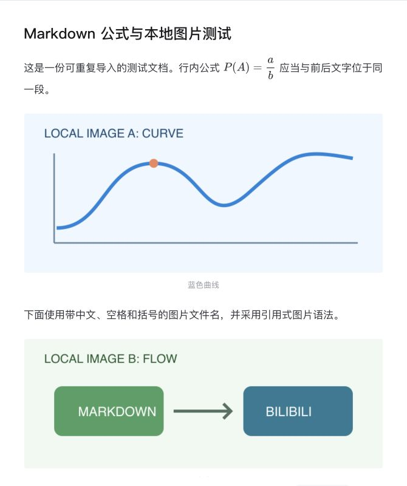
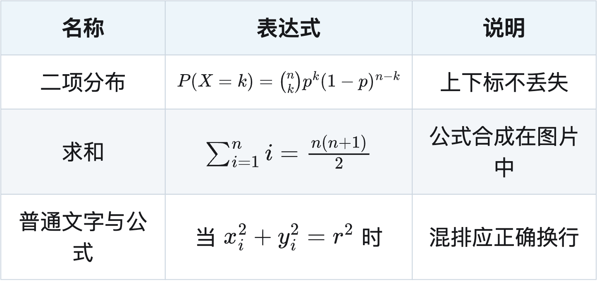

# Bilibili 专栏 Markdown 公式与本地图片导入

为 Bilibili 专栏编辑器补齐 Markdown 导入中的美元公式和本地图片。公式以 B 站原生可编辑节点导入，行内公式可以与文字处于同一段落。

**当前源码版本：0.3.4 · MIT · 非官方工具**

[安装用户脚本](https://github.com/Fat-pig-Cui/bilibili-markdown/releases/latest/download/bilibili-latex-import.user.js) · [下载示例文件夹](https://github.com/Fat-pig-Cui/bilibili-markdown/releases/latest/download/local-images-example.zip) · [版本记录](CHANGELOG.md) · [反馈问题](https://github.com/Fat-pig-Cui/bilibili-markdown/issues)

## 功能

- 将 `$...$` 和 `$$...$$` 转为原生公式，保留上下标、反斜杠及代码中的美元符号。
- 选择文档文件夹，上传本地图片，支持相对路径、引用式图片、HTML ``、中文/空格/括号文件名。
- 同一图片多次引用只上传一次，保留顺序、尺寸及题注；独立图片前不会多出空段落。
- 首行 `# 一级标题` 自动移至专栏标题框。
- 文件夹导入时将普通 Markdown 表格转成 PNG，保留列对齐、基本样式和表内公式；长表自动分页并重复表头。
- 可选图片水印，默认关闭；包含预检查、进度、取消及正文核对保护。



## 安装

使用用户脚本**无需安装 Node.js**。目前真实浏览器验证使用 Chrome + Tampermonkey；其他浏览器和 Violentmonkey 尚未逐项验证。

1. 在浏览器安装 Tampermonkey（建议从浏览器官方扩展商店安装）。
2. 点击上方“安装用户脚本”，在扩展的脚本安装页确认安装。
3. 刷新 B 站专栏编辑器。右下角出现“导入 Markdown 和图片”按钮即表示脚本已加载。

如果浏览器仅下载脚本，可在 Tampermonkey 新建脚本，粘贴 [userscripts/bilibili-latex-import.user.js](userscripts/bilibili-latex-import.user.js) 的完整内容并保存。更新时替换原脚本，避免同时启用多个版本。扩展管理器可通过脚本元数据检查 GitHub Release 的新版。

## 使用

### 只导入公式

正常使用 B 站原有 Markdown 导入功能即可。支持美元分隔符；`\(...\)` 和 `\[...\]` 请先转换为美元分隔符。行内代码和 fenced code block 不进行公式转换。

### 同时导入本地图片

1. 下载并解压示例 ZIP，或准备你自己的文档文件夹。
2. 打开**空白测试稿或已备份的稿件**，点击右下角“导入 Markdown 和图片”。
3. 选择同时包含 `.md` 和图片的文件夹；多个 Markdown 文档时，在下拉框中选择目标文档。
4. 检查识别结果，按需勾选“图片添加水印”，点击“上传图片并导入”。
5. 检查正文、标题和预览，再使用 B 站“保存为草稿”。脚本不会自动点击发布。


示例位于 [examples/local-images](examples/local-images)，包含两处公式、三个图片位置和两个 PNG 文件。应选择整个 `local-images` 文件夹，而不是仅选择 `article.md` 或 `assets`。若文档引用 `../assets/a.png`，需要选择覆盖文档与图片的共同父目录。

需要逐项验收编辑器功能时，使用 [examples/feature-coverage/article.md](examples/feature-coverage/article.md)，选择整个 `feature-coverage` 文件夹导入。它覆盖一至三级标题、字符样式、列表、链接、分割线、引用、代码、图片和两种美元公式（行间公式自动居中）；预期效果与线上状态见 [全功能验收清单](docs/feature-coverage.md)。

**导入会替换当前正文。** 如果第一行是非空一级标题，还会替换专栏标题；其加粗、链接等格式转换为纯文本。第一行不是一级标题时保留原专栏标题。上传期间手动修改正文或标题会停止替换。

### 导入表格

通过右下角的自定义面板“直接选择 .md 文件”即可，不必先截图；文档引用本地图片时，使用“选择文件夹”以授权读取图片。表格默认使用浅蓝表头和正文隔行斑马纹；单元格内容整体垂直居中，分页后底色顺序连续。预检查会生成表格 PNG，并显示表格数量和分页后的图片数量，点击导入后再上传。B 站原有 `.md` 文件导入入口暂不增强表格。

示例见 [examples/tables/article.md](examples/tables/article.md)（样式、三种列对齐、表内公式）和 [examples/tables/long-table.md](examples/tables/long-table.md)（60 行分页）；可以直接选择其中一个 `.md` 文件，也可选择整个 `tables` 文件夹后从下拉框中选文档。

表格转为图片后，单元格文字不能作为正文直接复制，链接不能单独点击，表内公式不能单独编辑；表外公式仍是原生节点。支持最多 8 列的独立管线表格；表内图片、嵌套于引用/列表的表格和 HTML 合并单元格会报错，请先调整文档。超长行、过宽公式和超出图片限额也会在上传前停止。



## 限制与数据流

- 本工具依赖 B 站编辑器内部的解析器和上传接口，站点更新可能导致失效。仅选择 `.md` 无法授权网页读取相邻图片，需使用文件夹导入。
- 普通图片仍为块级图片，公式为原生内联公式。图片格式、大小及数量受当前编辑器和账号限制；绝对路径、`file://`、选择范围外的文件会报错。
- 目录选择会把所选目录的文件集合提供给页面中的脚本。本工具只读取选定文档和其引用的本地图片，不上传整个目录；请勿选择包含无关私密资料的大目录。
- 文本与图片会进入 B 站编辑器；本地图片由当前账号的原生上传函数上传到 B 站，公式渲染会向 B 站公式接口发送 TeX。外站图片使用 B 站原生转存能力。不提供自建接收服务，不读取或导出登录 Cookie。
- 水印开关影响本次上传的本地图片和表格图片，不会去除原图或已有站内图片的水印。
- 已发出的上传无法保证撤回。取消或后续失败不会删除已上传图片；同一页面、相同文件及水印模式下可复用成功结果。
- 表格公式首次渲染时，从 jsDelivr 加载固定版本 MathJax 3.2.2，在隔离 iframe 内本地生成 SVG 后合成 PNG；不向该 CDN 发送文档或 TeX。加载失败会停止导入。表外原生公式仍使用 B 站公式接口。
- 未明确支持的其他语法沿用 B 站原生导入行为，不保证完整还原。请使用可信文档并在保存前检查。

## 已验证范围

2026-10-29 的真实 B 站编辑器验证覆盖原生行内公式、上下标、本地 PNG、中文/空格/括号路径、引用式图片、重复引用、题注、保存后重开草稿、图片前空段落修复及两个面板关闭入口。没有执行发布。

其他图片格式、外站转存、不同浏览器、线上风控和异常网络尚未逐项实测。自动测试中的上传和原生编辑器使用替身，不能代替线上验证。公开截图已裁去账号区域，验证 JSON 已移除草稿标识并替换上传图片地址。

- [编辑器与公式分析](docs/editor-analysis.md)
- [本地图片导入分析与历史核验](docs/local-image-import-analysis.md)

## 开发

使用 Node.js 24（见 [.nvmrc](.nvmrc)），npm 依赖版本由锁文件固定：

```bash
npm ci
npm run check
npm test
```

目前有 41 项自动测试。CI 执行语法检查和测试，不登录 B 站或上传文件。用户脚本是独立文件，无须构建或打包依赖即可安装。表格 Canvas、公式合成和分页已在真实 Chrome 本地验收页检查，0.3.1 表格上传、原生公式及保存重开已在 B 站测试稿验证；0.3.3 的垂直居中、斑马纹、表内公式及题注也已在 B 站测试稿重新导入、保存重开验证。

### 离线公式图片转换器

仓库保留备用 CLI，可将公式渲染为 PNG/SVG。图片是块级内容，无法提供原生行内公式编辑；优先使用用户脚本。

```bash
node src/cli.mjs examples/formula.md -o ./dist/formula
# 可选 --svg；--svg --data-uri 可生成包含公式 SVG 的单文件 Markdown。
```

输出包括改写后的 Markdown、`formula-assets/` 和 `manifest.json`。转换器使用 MathJax 的 `base`、`ams`、`newcommand`、`color` 包；不支持的宏会报告错误。图片文件仍需通过文件夹导入上传。生成清单包含本机输入/输出路径，不应直接公开。

## 贡献与许可

反馈与贡献方式见 [CONTRIBUTING.md](CONTRIBUTING.md)，安全问题见 [SECURITY.md](SECURITY.md)。本项目原创代码、文档和示例图片采用 [MIT](LICENSE)；依赖及 Bilibili 页面元素的说明见 [THIRD_PARTY_NOTICES.md](THIRD_PARTY_NOTICES.md)。项目未获 Bilibili 官方背书。
