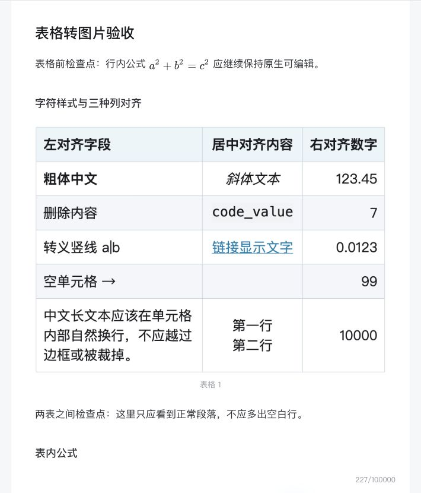
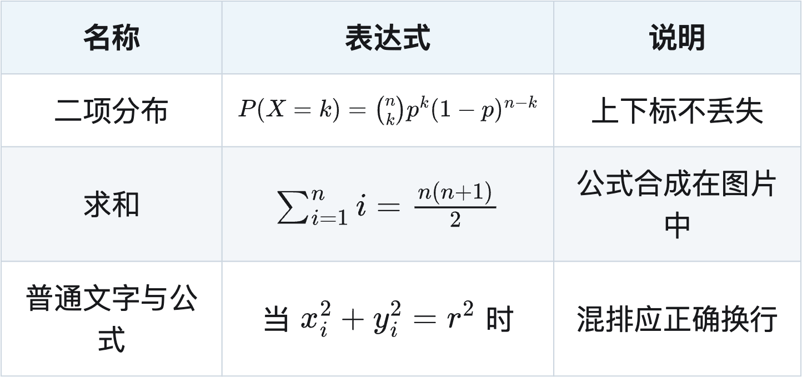
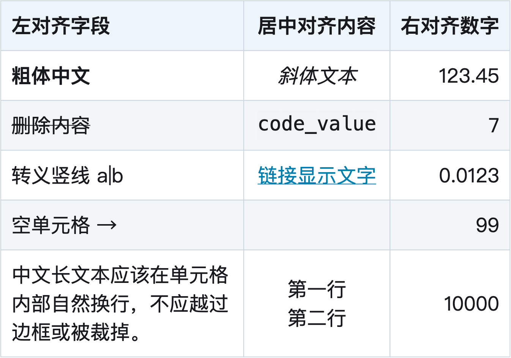

# 表格转图片导入

版本：0.3.4。使用右下角“导入 Markdown 和图片”面板的“直接选择 .md 文件”选择文档；引用本地图片时改用“选择文件夹”。表格图片在预检查期间生成，显示预计上传数量后，再点击“上传图片并导入”。原生 `.md` 导入入口暂不增加表格转换。

## 支持范围

- 独立 Markdown 管线表格，最多 8 列、2000 个单元格、50000 个字符。
- 浅蓝表头、正文隔行斑马纹（跨分页连续）、左/中/右列对齐、单元格内容整体垂直居中、中文、数字、空单元格、转义竖线、粗体、斜体、删除线、代码文字和 ` ` 换行。
- 链接保留显示文字及颜色，但图片内的链接不可点击。
- 表内美元公式渲染后合成到 PNG；表外美元公式继续使用 B 站原生节点。
- 输出 2 倍像素密度的白底 PNG，按完整行分页，每页重复表头；图片题注注明表格和分页编号。
- 同一行存在多行单元格时，其他单元格在完整行高内垂直居中；文字、代码及表内公式都按整块内容高度居中，保留单元格内换行。

表内图片、HTML 表格及合并单元格、引用/列表内嵌套表格会明确报错。单行无法完整容纳、公式缩小后过小、图片数量或大小超限时也会停止，不静默截断。需要修改单元格时，请修改原 Markdown 并重新导入。

## 实现与数据流

在 `planImport()` 中读取文档并保护公式后，创建与 B 站预处理隔离的 Markdown-it 实例，使用 token 和源行范围提取表格；代码块内伪表格不转换。Canvas 负责布局、换行和绘制，没有采用 HTML 网页截图依赖。

表内公式首次使用时，在隔离 iframe 内从 jsDelivr 加载固定版本 MathJax 3.2.2。关闭自动排版、字体缓存采用内嵌路径，生成完整 SVG 后作为本地 Blob 图片绘入 Canvas；文档与 TeX 不发送给该 CDN。公式渲染失败则停止预检查。该 iframe 不扫描或修改编辑器正文，卸载脚本时移除。

生成的 PNG File 以临时图片引用替换内存里的表格源范围，不改写磁盘源文件；预检查与导入复用同一次生成结果。它们与已有图片共同接受 MIME、大小和总数量校验，随后沿用原生 `uploadHandler()`、水印选项、并发限制、成功结果缓存和提交后图片核对。上传前的渲染失败、超限、上传期间正文变化或上传失败，都不会提交新正文；已发出的上传仍无法撤回。

## 示例与验证

- [样式、列对齐及表内公式](../examples/tables/article.md)：2 张表格和 2 处表外原生公式。
- [60 行长表](../examples/tables/long-table.md)：每页重复表头，当前 Chrome 渲染结果为 3 张 PNG。
- 41 项本地测试通过，覆盖独立解析器、转义竖线、代码保护、分页、单文件选择、图片限额、上传失败与正文保护；上传和编辑器在自动测试中使用替身。
- 已在真实 Chrome 本地验收页执行生产脚本的 Canvas 绘制、隔离 MathJax 加载、SVG 合成、PNG 导出及分页，并检查实际生成图片。
- 0.3.1 已在 B 站测试稿核对实际上传并保存重开：两张表格图片加载正常，两处表外公式仍为原生节点，行间公式继续居中；题注和正文顺序保留。记录见 `validation/table-import-0.3.1.json`。测试稿未发布。
- 0.3.2 的斑马纹已在本地 Chrome 生成图片并检查实际 PNG 像素；额外把长表表头增加一行以形成每页 19 行的场景，四页底色顺序及重复表头检查通过，记录见 `validation/table-zebra-0.3.2.json`。跨页底色连续性以本地 PNG 检查为证；B 站两张表格的新版导入见下方 0.3.3 验收。既有图片不会自动换色。

- 0.3.3 在 Chrome 实际 PNG 中检查示例最后一行：三行文字、两行文字和单行数字的墨迹中心距行中心分别约 0.8、0.3 和 0.05 个逻辑像素；隔行底色检查仍通过。41 项测试通过。记录见 `validation/table-vertical-center-0.3.3.json`。

- 0.3.3 已在 B 站测试稿重新导入并保存重开：两张图片均正常加载，斑马纹与单元格垂直居中保留，题注仍为“表格 1”“表格 2”，两处表外原生公式及行间居中保留。正文顺序正常，未发布。记录见 `validation/table-import-0.3.3.json`。

