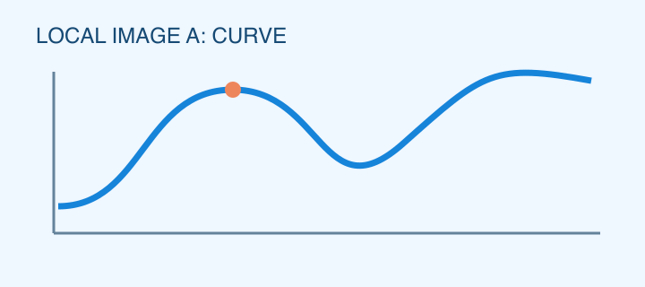

# Markdown 全功能导入验收

这是格式验收专用文档。首行应移至专栏标题；下面的一级标题应保留在正文。所有“检查点”文字用于定位，不应丢失。

# H1 检查点：正文一级标题

一级标题下面的普通段落，应与标题分开。

## H2 检查点：正文二级标题

二级标题下面的普通段落，应与标题分开。

### H3 检查点：正文三级标题

三级标题下面的普通段落，应与标题分开。三个标题层级应有区别。

## 字符样式检查点

普通文字与 **粗体检查点** 应有明显区别。

普通文字与 *斜体检查点* 应有明显区别。

普通文字与 ~~删除线检查点~~ 应有明显区别。

组合样式：***粗斜体检查点***，~~**粗体删除线检查点**~~。

代码对照：`**这不是粗体**`、`*这不是斜体*`、`~~这不是删除线~~` 应保留语法原文。

## 有序列表检查点

1. 有序第一项：普通文字。
2. 有序第二项：包含 **粗体列表检查点**。
3. 有序第三项：包含行内公式 $a_1+a_2=a_3$，公式前后文字应在同一列表项。

列表后普通段落：应退出编号列表。

## 无序列表检查点

- 无序第一项：普通文字。
- 无序第二项：包含 *斜体列表检查点*。
- 无序第三项：包含 [列表链接检查点](https://www.bilibili.com/)。

列表后普通段落：应退出项目符号列表。

## 超链接检查点

这段文字之前是普通文本，[Bilibili 链接检查点](https://www.bilibili.com/)，之后也是普通文本。链接文字及目标地址都应保留。

## 分割线检查点

分割线上方检查点。

---

分割线下方检查点。上下文字之间应只有一条独立横线。

## 引用检查点

> 引用第一段检查点：这段文字应处于引用块。
>
> 引用第二段检查点：包含 **引用粗体检查点**、*引用斜体检查点* 和 [引用链接检查点](https://www.bilibili.com/)。

引用外检查点：这段应恢复为普通段落。

## 代码块检查点

```python
def square(x):
    return x ** 2

# $not_math$ $$not_display_math$$
# **not_bold** ~~not_strike~~
# 
print(square(3))  # 9
```

代码块外检查点：应恢复普通文字；代码块中的缩进、换行、美元符号与图片语法应完整保留。

## 图片检查点

图片上方检查点：下一块应为本地曲线图，前面不应额外生成空段落。



图片下方检查点：曲线图应加载成功，题注保留，尺寸比例为 720×320。

## 行内公式检查点

行内公式前检查点 $P(X=k)=\binom{n}{k}p^k(1-p)^{n-k}$ 行内公式后检查点。公式应与左右文字处于同一段，上下标和反斜杠不能丢失。

同段多公式检查点：$x_i^2$ 加上 $y_i^2$ 等于 $r^2$，文字顺序不应改变。

代码对照：`$not_a_formula$` 和 `$$not_a_display_formula$$` 应保留原样，不生成公式。

## 行间公式检查点

行间公式上方检查点：下面的求和公式应独占一段并居中，公式分隔符不应显示。

$$
\sum_{i=1}^{n} i = \frac{n(n+1)}{2}
$$

行间公式中间检查点：下面的多行公式应整体居中，并保留两行和内部对齐关系。

$$
\begin{aligned}
f(x) &= x^2 + 2x + 1 \\
     &= (x+1)^2
\end{aligned}
$$

行间公式下方检查点：应恢复普通段落；公式应独占一段并居中，且仍可原生编辑。

## 结束检查点

如果能看到这一段，说明正文未在图片、代码块或公式处截断。检查标题、样式、列表、链接、分割线、引用、代码、图片与公式后，再保存为测试草稿并重新打开核对。
